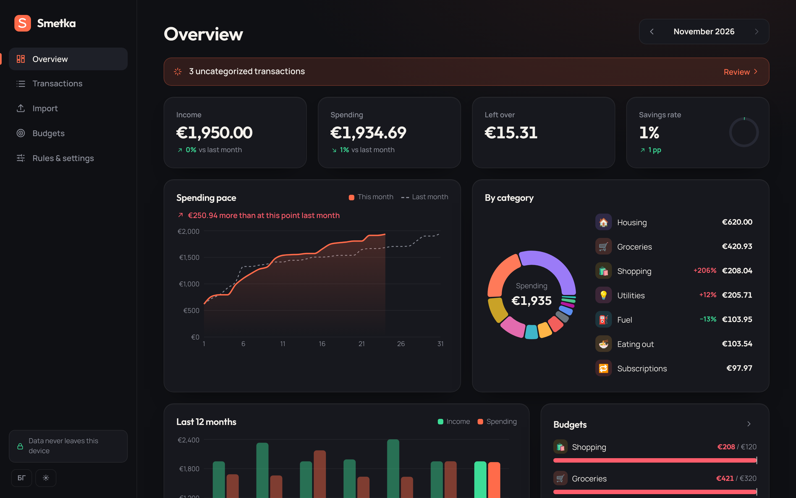
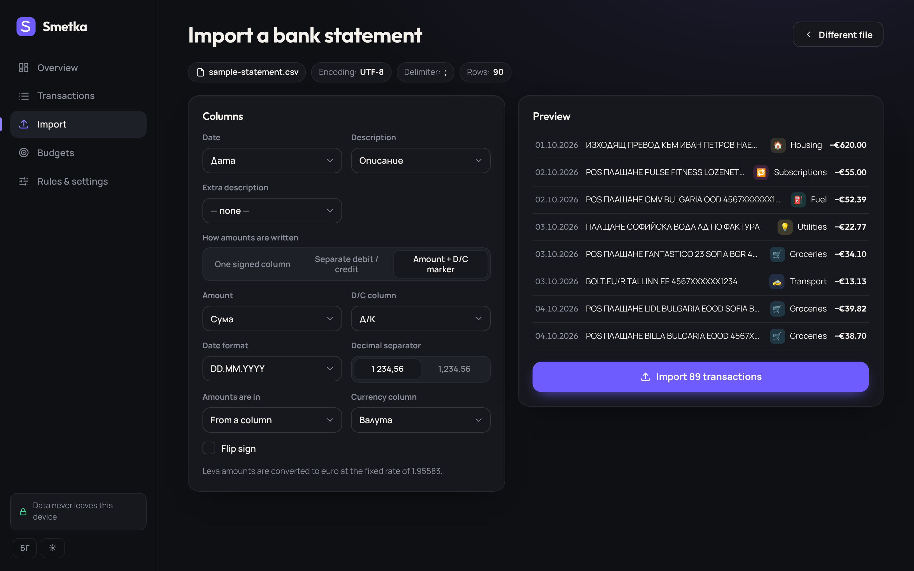
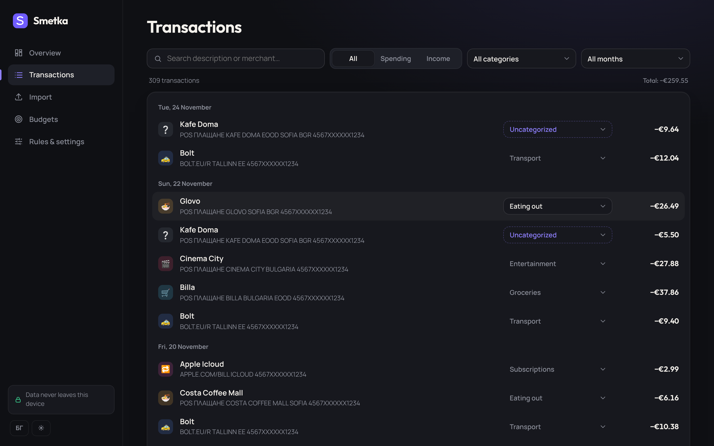

# Smetka

**A private personal-finance dashboard.** Drop in a statement from your bank as CSV, Excel or PDF. Smetka works out the format, categorizes every transaction, tracks budgets and finds your subscriptions. Nothing leaves the browser: there's no server, no account and no upload.

> *Сметка* is Bulgarian for “account” and “bill”.



| Import wizard | Transactions |
|---|---|
|  |  |

## What it does

- **Reads PDF statements, in the browser.** pdf.js pulls out the positioned text, and Smetka rebuilds the table from it. A row is a line that starts with a date at the usual date position and holds an amount. Wrapped descriptions are joined back together. Columns are found from where cells line up across rows: text on the left edge, numbers on the right. Opening balances, totals, repeated headers and page footers are skipped. Scanned PDFs (images only) are detected and explained instead of failing silently.
- **Knows your balance.** A running-balance column ("Салдо") or a closing-balance line in a statement is read automatically, or you type in today's balance. From those points and the transactions, Smetka works out the balance on every day and charts it month by month. Each known point re-anchors the line, so a missing transaction only skews the days until the next one.
- **Imports many files at once.** Drop a year of monthly statements together. Files with the same layout share one column mapping, each file still gets its own duplicate check and its own undo, and unreadable files (scans, empty exports) are listed instead of stopping the rest.
- **Reads Excel files** (.xlsx, e.g. Revolut exports). It picks the sheet that looks like a statement.
- **Imports messy bank exports.** UTF-8 or Windows-1251, `;` `,` or tab delimiters, account-info preamble lines before the table, `DD.MM.YYYY` / ISO / US dates, `1 234,56` or `1,234.56` amounts, and debit/credit columns or `Д/К` markers. Columns are guessed from header names first and cell contents second, and you can correct the guess in a live preview.
- **Remembers each bank's format.** The column mapping is saved against the header row's signature, so the second import from the same bank is one click.
- **Never double-counts.** Each row gets a stable fingerprint, so overlapping exports skip what's already there. Identical rows inside one file (two €2.50 coffees on the same day) stay separate.
- **Handles the lev-to-euro switch.** Bulgaria adopted the euro on 1 Jan 2026. Leva amounts are converted at the fixed 1.95583 rate. Without a currency column, dates before 2026 are treated as leva automatically.
- **Categorizes automatically, then learns.** More than 230 built-in rules cover merchants common in Bulgaria, in both Latin and Cyrillic spelling. When you change a category, Smetka offers to remember the merchant, re-categorizes the matching history and applies the rule to future imports. Manual choices are never overwritten.
- **Finds subscriptions.** It looks for charges from the same merchant at regular intervals for a steady amount. Groceries don't qualify because the amounts vary. It also flags price increases and shows the yearly cost.
- **Projects budgets.** Monthly limits per category with a month-end projection at the current pace. It can also suggest a limit from your last three months.
- **Undo, backup, restore.** Any import can be rolled back. All data exports to and restores from JSON.
- Bulgarian and English, dark and light themes, works on mobile, keyboard-accessible custom controls, respects `prefers-reduced-motion`.

## Try it

Open the app and click **Try with demo data**, or go to **Import** and try the sample **CSV** or **PDF** statement. The demo generates about seven months of realistic Sofia-based finances that end today. The descriptions use real export formats, so they go through the same categorizer as your own data.

## Tech

| | |
|---|---|
| UI | React 19 + TypeScript, hand-built components (select, segmented control, modal, toasts) |
| Storage | IndexedDB via Dexie, with live queries so every view updates when data changes |
| Parsing | PapaParse for CSV, pdf.js for PDF (loaded only when needed, worker started from a blob URL), read-excel-file for .xlsx, plus custom table, header, date and amount detection |
| Charts | Recharts |
| Tests | Vitest: parsing, PDF table reconstruction (against real pdf.js output), categorization, dedup, recurring detection, budgets |
| Build | Vite, pages lazy-loaded, deployed to GitHub Pages by GitHub Actions |

```
src/
  lib/          pure logic, no React. This is the part worth reading.
    csv.ts          decoding, table detection, column guessing, row mapping, fingerprints
    pdfTable.ts     rebuilds the transaction table from positioned PDF text
    fileImport.ts   picks CSV / Excel / PDF by magic bytes, loads pdf.js and the Excel reader on demand
    money.ts        amount parsing, BGN→EUR
    dates.ts        date formats and detection
    categorize.ts   merchant extraction, rule engine
    categories.ts   categories and built-in rules
    recurring.ts    subscription detection
    balance.ts      balance on any day from statement/manual snapshots + transactions
    stats.ts        monthly summaries, pace, budget projections
    demo.ts         demo data and sample bank CSV
  db.ts         IndexedDB schema, import, learning, undo, backup
  pages/        Overview, Transactions, Import, Budgets, Settings
  ui.tsx        shared components
```

## Run locally

```bash
npm install
npm run dev        # http://localhost:5173
npm test           # unit tests
npm run build      # static site in dist/
npm run build:single   # everything inlined into one index.html
python3 scripts/make-sample-pdf.py   # regenerate public/sample-statement.pdf (needs reportlab)
```

## Deploy

Push to `main`. The workflow in `.github/workflows/deploy.yml` runs the tests, builds the site and publishes it to GitHub Pages. In the repository settings, set **Pages → Source** to **GitHub Actions** once.
